# Bataan Digital Infrastructure Portal: Interpretation & User Guide

**Interactive Portal URL**: [https://quizoli.github.io/Bataan-Internet/](https://quizoli.github.io/Bataan-Internet/)  
**Access Password**: `onebataan`  
**Governing Regulatory Policy**: Republic Act No. 12234 (*Konektadong Pinoy Act* - Open Access in Data Transmission)  
**Provincial Framework**: BatFIRST (*Bataan Fiber Infra Resiliency & Sustainable Transformation*)

---

## 1. Executive Summary & Purpose of the Portal

The **Bataan Internet & Fiber Infrastructure Portal** is an interactive GIS intelligence platform and executive decision-support system. It integrates two primary data streams:

1. **Physical Asset Inventory (As-Built November 2024)**: 385 fiber segments totaling **1,171.96 km** and **32 telecom facilities/nodes** extracted directly from national and regional carrier route surveys across Bataan.
2. **Provincial Economic & Resiliency Master Plan (BatFIRST & Lipad v5)**: Identification of critical demand clusters, industrial ecozones, municipal government hubs, and the urgent strategic mandate for a **360° closed-loop self-healing fiber ring**.

The portal allows provincial leaders, planning engineers (PPDO), LGU executives, and private telecom/ISP partners to visualize where fiber capacity exists, where severe vulnerability bottlenecks reside, and where strategic public investments must occur.

---

## 2. Visual Guide: How to Read the Map Elements

When viewing the map, each layer and visual color represents a distinct physical or strategic asset:

| Map Symbol & Color | Layer Name | Physical Meaning & Specifications | Strategic Significance |
| :--- | :--- | :--- | :--- |
| **Solid Orange Line** (`#ff7849`, 3.5px) | **Underground Backbone** | Heavy-duty HDPE conduits and direct-buried fiber optic cables located beneath road shoulders. | **High Resiliency**: Shielded from category 5 typhoons, tree falls, and roadside vehicle crashes. Concentrated on the eastern Roman Superhighway. |
| **Solid Blue/Cyan Line** (`#38bdf8`, 2.5px) | **Aerial Backbone FOC** | Fiber optic cable lashed to utility/electric distribution poles overhead. | **High Vulnerability**: Highly susceptible to storm damage, falling branches, and power pole collapses. Covers the western flank and mountainous passes. |
| **Dashed Yellow Line** (`#fbbf24`, 4px) | **Civil Handhole Spans** | Pre-cast concrete junction boxes / handholes spaced every 300m–500m along the road. | **Access Points**: Where backbone cables can be safely spliced and tapped to bring fiber to schools, hospitals, barangays, and businesses. |
| **Dashed Pulsing Red Line** (`#f43f5e`, 4px) | **Proposed Resiliency Ring (Bagac–Mariveles)** | **The 43.28 km Missing Link**: Unbuilt coastal segment currently marked *Not Implemented*. | **Critical Vulnerability**: Mariveles and Bagac are currently dead-end spurs. Closing this ring creates an automated, self-healing loop for the entire peninsula. |
| **Purple Circle with Radio Icon** (`#a855f7`) | **Telecom Core Nodes (32)** | Central Offices (CO), Points of Presence (POPs), Optical Line Terminals (OLT), and BTS shelter huts. | **Interconnection Hubs**: Classified into Shelter Classes A, B, and C with backup power configurations. |
| **Green Diamond Icon** (`#10b981`) | **Economic Growth Anchors (12)** | Key industrial, logistical, educational, and governance centers from the *Lipad v5* master plan. | **Demand Off-Take**: High-bandwidth off-takers that justify dark fiber leasing and public-private investments. |
| **Blue Pin Marker** (`#3b82f6`) | **Municipal Centers (12)** | Municipal Halls and city center coordinates across all 11 towns + Balanga City. | **e-Gov & Community Access**: Fast zoom anchors for local government territorial reviews. |

---

## 3. How to Interpret the Strategic Story: The "So What?"

```mermaid
flowchart TD
    subgraph CurrentTopology["CURRENT VULNERABILITY: DEAD-END SPUR"]
        A[Subic / Pampanga Interconnect] --> B[Dinalupihan / Hermosa Hub]
        B -->|East Corridor Heavy Underground| C[Balanga City Government Hub]
        C -->|East Corridor Single Trunkline| D[Limay Industrial / Energy Complex]
        D -->|Single Trunkline| E[Mariveles Freeport FAB - DEAD END]
        B -.->|Fragile Mountain Aerial| F[Morong / Bagac - DEAD END]
        style E fill:#ffe4e6,stroke:#f43f5e,stroke-width:2px
        style F fill:#ffe4e6,stroke:#f43f5e,stroke-width:2px
    end

    subgraph ProposedTopology["BatFIRST TARGET: 360° CLOSED-LOOP SELF-HEALING RING"]
        Ring1[East Corridor: Underground Trunk] <--> Ring2[Mariveles Terminal FAB]
        Ring2 <==>|PROPOSED 43.28 km PPP CONDUIT| Ring3[Bagac Eco-Tourism Hub]
        Ring3 <--> Ring4[West Flank: Morong / Subic]
        Ring4 <--> Ring1
        style Ring2 fill:#ecfdf5,stroke:#10b981,stroke-width:2px
        style Ring3 fill:#ecfdf5,stroke:#10b981,stroke-width:2px
    end
```

### The Three Critical Insights

#### Insight 1: The Asymmetric East-West Infrastructure Divide
- **The East Corridor (Roman Superhighway)** possesses **334.85 km** of buried underground conduit. This is the industrial spine of Bataan connecting Hermosa, Balanga, Orion, Limay, and Mariveles.
- **The West Corridor (Morong, Bagac)** relies on **aerial cables** strung through steep mountain jungle passes. During heavy typhoons or landslides along the Gov. Linao highway, West Bataan suffers total telecommunication blackouts.

#### Insight 2: The High-Stakes Mariveles Vulnerability
- **Freeport Area of Bataan (FAB)** is a multi-billion-peso national economic driver hosting semiconductor manufacturers, BPOs, fintech, and light industry.
- In the current topology, fiber down the eastern highway forms a **single long antenna (spur)** terminating at Mariveles. If a construction backhoe accidentally cuts the conduit in Limay or Orion, Mariveles loses high-capacity connectivity with no automated alternative route.

#### Insight 3: The Resiliency Ring Solution (The Red Line)
- By constructing **43.28 km of underground multi-duct conduit between Bagac and Mariveles** (via the Bagac-Mariveles coastal road alignment), Bataan achieves a **closed-loop ring**.
- In carrier networking, a ring topology enables **Automatic Protection Switching (APS)**: if fiber is severed anywhere on the east side, traffic immediately reverses direction and routes through the west side in under 50 milliseconds.

---

## 4. Operationalizing the BatFIRST Open-Access Model

The portal highlights how Bataan leverages **Republic Act No. 12234 (Konektadong Pinoy Act)**:

1. **The "Tollway" Analogy**:
   - The Provincial Government of Bataan finances and owns the physical underground civil works (trenches, conduits, manholes, handholes, solar-battery node shelters).
   - A licensed private **Data Transmission Industry Participant (DTIP)** concessionaire maintains the active optical equipment and operates the Network Operations Center (NOC).
   - Any licensed ISP, telco, cable TV operator, or community micro-ISP can lease fiber strands on equal, non-discriminatory (**FRAND**) terms, paying standard volume-based tariffs.

2. **The "Dig-Once" Policy**:
   - Installing empty conduits during scheduled DPWH road widenings, bridge replacements, and provincial civil works costs **~₱600,000 to ₱1.2M per km**.
   - Retrofit trenching through existing paved asphalt costs **₱3.5M to ₱6M per km**.
   - Coordinating civil works saves Bataan over 60% of capital expenditure.

3. **Solar 48V DC Node Hardening**:
   - The 32 telecom nodes on the map must be resilient against prolonged grid power failure.
   - Nodes are decoupled from the AC grid via dedicated **48V DC bus architectures backed by solar arrays and Lithium Iron Phosphate (LiFePO4) battery banks**, guaranteeing 72+ hours of autonomous operation during natural disasters.

---

## 5. How to Navigate the Site

### On Desktop (Laptops & Large Displays)
1. **Left Panel (Control Center)**:
   - **Basemap Style**: Choose between **ESRI Street Map** (high-contrast roads), **ESRI Satellite** (inspecting terrain, tree canopies, and elevation), **Dark Gray Canvas** (clean NOC-style presentations), and **OpenStreetMap** (public landmarks).
   - **Network Overlays**: Use checkboxes to isolate layers (e.g., turn off Aerial Fiber to view only hardened Underground Conduits).
   - **Jump to Municipality**: Click any municipality name to smoothly pan and zoom directly to that town hall.
2. **Right Floating Drawer (Inspector Card)**:
   - Click on any fiber line segment, node dot, or diamond marker to view its detailed specifications (length in meters, municipality, shelter type, economic impact).
   - Switch between **Strategy**, **DTIP Framework**, and **Corridors** tabs at the top for executive whitepapers.

### On Mobile (Smartphones & Tablets)
1. **Full-Screen Map View**: The map occupies 100% of the mobile screen so roads and lines are never obscured.
2. **Floating Pill Buttons at the Bottom**:
   - Tap **`🎛️ Layers & Styles`** to open the bottom sheet where you can change basemaps and toggle network lines.
   - Tap **`📊 Overview`** to open the strategic brief and metrics drawer.
3. **Closing Drawers**:
   - Tap the **`✕ Close`** button on top of any sheet, or tap anywhere on the dark backdrop or map surface to dismiss the sheet and return to the map.

---

## 6. Recommended Action Items for Decision Makers

1. **Prioritize Right-of-Way for the Bagac–Mariveles Corridor**: Formalize inter-agency agreements between the Provincial Engineering Office (PEO), DPWH 2nd District Engineering Office, and AFAB to reserve conduit space along the southern coastal alignment.
2. **Enact the Provincial "Dig-Once" Ordinance**: Require all public road projects in Bataan to lay standard 4-way HDPE microducts as part of civil contracting.
3. **Establish the Bataan Neutral Interconnection Hub**: Leverage the 1Bataan Command Center in Balanga as the provincial peering point, linking local educational institutions (BPSU) and disaster response teams directly to the fiber backbone.
