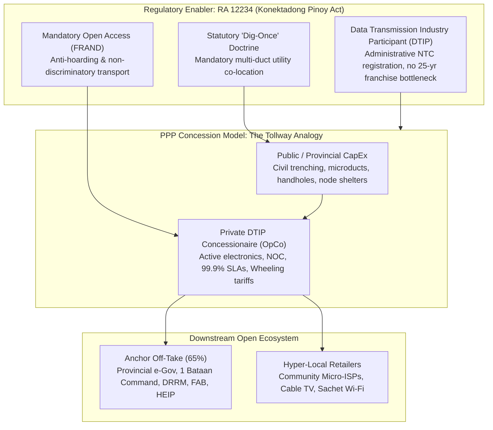

# Bataan Internet Infrastructure Portal (BatFIRST)

[](https://quizoli.github.io/Bataan-Internet/)
[](https://quizoli.github.io/Bataan-Internet/)
[](https://quizoli.github.io/Bataan-Internet/)

Interactive provincial GIS portal and digital infrastructure blueprint for **Bataan Province**, operationalizing the **BatFIRST** (*Fiber Infra Resiliency & Sustainable Transformation*) initiative and integrating national/regional fiber backbone networks under the **RA 12234 (Konektadong Pinoy Act)** DTIP framework.

🌐 **Live Portal**: [https://quizoli.github.io/Bataan-Internet/](https://quizoli.github.io/Bataan-Internet/)  
📖 **Comprehensive Interpretation & User Guide**: [PORTAL_USER_GUIDE.md](PORTAL_USER_GUIDE.md)

---

## 🏛️ Strategic Project Overview

The Bataan Provincial Digital Blueprint (**BatFIRST**) operationalizes a **Public-Private Partnership (PPP) Open-Access Tollway Concession**:



1. **The Tollway Concession Analogy**: Like public expressways (e.g. SCTEX), the provincial government funds foundational civil works (trenching, conduits, handholes, shelters) as permanent public assets. A private DTIP concessionaire deploys active electronics, operates the network, and charges volume-based wheeling tariffs per Gbps-kilometer.
2. **The "Dig-Once" Economic Synergies**: Civil trenching accounts for >50% to 70% of deployment costs. Synchronizing conduit placement with DPWH and LGU road construction slashes per-kilometer costs by over two-thirds.
3. **Power Resilience**: Active telecom nodes utilize direct **48V DC solar-battery bus connections**, completely isolating electronics from grid surges and power outages.
4. **Resiliency Topology**: Closing the southwestern coastal gap (**Bagac to Mariveles**) to convert the open-ended spur into a **360° closed-loop, self-healing municipal fiber ring**.

---

## 🗺️ Network Footprint Metrics

Data compiled and mapped from the November 2024 National & Regional Backbone GIS report:

| Infrastructure Category | Segments | Total Length (km) | Alignment & Physical Corridor |
| :--- | :---: | :---: | :--- |
| 🟠 **Underground Backbone Conduits** | 81 | **334.85 km** | Roman Superhighway (Dinalupian to Orion), Orion to Mariveles, San Fernando to Hermosa |
| 🔵 **Aerial Backbone FOC** | 227 | **773.68 km** | Trans-peninsular span (Pilar to Bagac), Subic to Morong, Layac to Olongapo, municipal distribution |
| 🟡 **Civil Handhole Spans** | 50 | **20.15 km** | High-density pre-cast handholes (~300m–500m) in Balanga, Hermosa, and Abucay |
| 🔴 **Unbuilt Gap (Spur Deficit)** | 2 | **43.28 km** | Southwestern Coast corridor (Bagac to Mariveles) marked *Not Implemented* |
| **Total Tracked** | **385** | **1,171.96 km** | Touching all 11 Municipalities + 1 City of Bataan |

---

## 🚀 Features of the Portal

- **Live GIS Footprint**: Interactive Leaflet map with layer toggles for underground conduits, aerial backbones, civil handholes, core telecom nodes, demand anchors, and the proposed ring closure.
- **Multiple Basemaps**: Carto Dark Matter (telecom NOC view), Carto Voyager, ESRI High-Resolution Satellite, and OpenStreetMap.
- **LGU Quick-Zoom**: Instant navigation to any of the 12 municipal centers across Bataan.
- **Segment & Node Inspector**: Interactive drawer displaying technical specs, lengths, shelter classes, and BatFIRST concession notes.
- **Executive Blueprint & DTIP Tabs**: Complete policy reference, linear rights-of-way guide, and growth engines directory.
- **Data Downloads**: One-click access to JS/GeoJSON vectors and PDF briefings.

---

## 📂 Repository Structure

```
├── index.html                   # Main portal entry point (GitHub Pages ready)
├── bataan_fiber_data.js         # Structured vector dataset (385 lines, 32 nodes, 12 anchors)
├── bataan_extracted_features.json # Raw extracted GeoJSON features
├── batFIRST.pdf                 # Provincial Digital Blueprint briefing document
├── 10-02_Pulong_...-Summary.pdf # Master plan meeting and stakeholder proceedings summary
├── scripts/
│   ├── extract_fiber_data.py    # Python KMZ parser & geospatial extractor
│   ├── build_bataan_fiber_map.py# Standalone map builder
│   └── build_portal.py          # Portal generator script
└── .gitignore                   # Excludes large files exceeding GitHub limits (>50MB)
```

---

## ⚙️ Running Locally

No server or build process required. Simply open `index.html` in any modern web browser:

```bash
open index.html
```

Or start a local web server:

```bash
python3 -m http.server 8000
# Visit http://localhost:8000
```

---

## 📜 Regulatory Reference

- **Republic Act No. 12234**: *Konektadong Pinoy Act* (Data Transmission Industry Participant Framework)
- **Republic Act No. 11453**: *Authority of the Freeport Area of Bataan (AFAB) Expansion Act*
- **DENR DAO 2013-22**: *WEEE Telecom E-Waste Compliance and Infrastructure Recovery*
